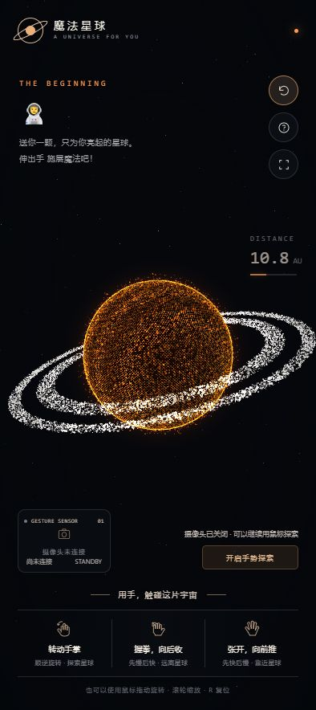
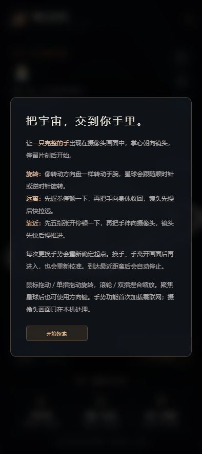

# 魔法星球

**A Planet FOR YOU**

送你一颗，只为你亮起的星球。  
伸出手，施展魔法吧。

 &nbsp; 

星球主界面 · 手势操作说明

## 01 · 开启你的星球

1. **打开网页链接**，允许使用摄像头。
2. **等待手势资源加载**，看到“伸出一只手，让星球感受你”即可开始。
3. **掌心朝向镜头**，让一只完整的手出现在左下角预览中。

首次打开需联网加载，请稍候。摄像头画面只在你的设备上处理，不上传、不保存。

## 02 · 三个动作，自由探索

| 想做什么 | 这样操作 | 你会看到 |
| :--- | :--- | :--- |
| **旋转星球** | 像转方向盘一样，轻轻转动手腕 | 星球跟随手腕顺时针或逆时针旋转 |
| **远离星球** | 先握拳，停顿一下，再把手向身体收回 | 视角先慢后快拉远，星球逐渐变小 |
| **靠近星球** | 先五指张开，停顿一下，再把手推向镜头 | 视角先快后慢靠近，到最近位置自动停下 |

> **Tips** · 保持光线充足、掌心正对镜头，动作缓慢连贯。想再推近或拉远一次，把手移出画面再放回来，即可重新开始。

## 03 · 随手可用的小工具

| 界面位置 | 用途 |
| :--- | :--- |
| **右上角 ↺** | 回到初始视角，也可以按键盘 **R** |
| **右上角 ?** | 随时查看手势说明 |
| **右上角全屏图标** | 切换全屏，沉浸探索 |
| **右侧 DISTANCE** | 查看距离：数字越小，离星球越近 |
| **左下角预览** | 确认手是否完整入镜；捕捉成功后显示手部骨架 |
| **右下角摄像头按钮** | 关闭摄像头，或重新开启手势探索 |

**不用摄像头，也能玩。** 鼠标拖动旋转、滚轮缩放；手机单指拖动、双指捏合缩放。

## 遇到一点小状况？

- **手势没反应**：确认手已完整入镜，换个明亮的位置；新手势先停顿一下再移动。
- **加载失败**：检查网络，点击“开启手势探索”重试。
- **微信无法开启摄像头**：点右上角“…”选择在浏览器中打开，并允许摄像头权限。